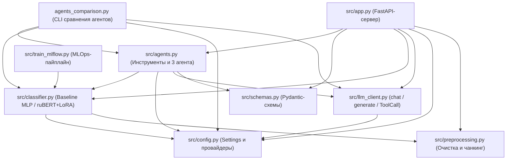
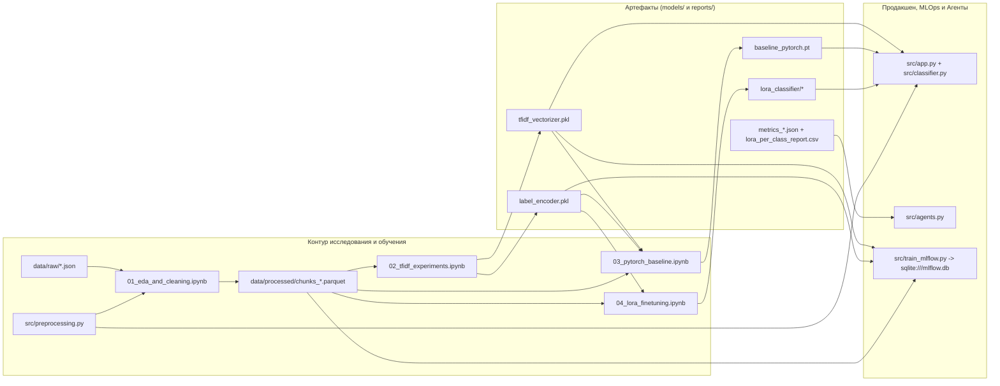

# Полное устройство кодовой базы: структура, принципы работы и взаимосвязь всех частей кода

Этот документ — подробный технический справочник («карта кода») по проекту **Literary Style Assistant**. В нём последовательно разобраны:
1. **Полная структура файлов и папок проекта** (что где лежит и зачем нужен каждый файл).
2. **Принципы проектирования** (почему код написан и разделён именно так).
3. **Полная взаимосвязь всех частей кода** (граф импортов, связь обучения и продакшена, пошаговые трассировки запросов `/ask` и `/agent`).
4. **Детальный разбор каждого модуля в `src/`** (все классы, функции, инструменты и агенты с точными ссылками на строки).
5. **Разбор исследовательских ноутбуков `notebooks/` и артефактов `models/`.**
6. **Разбор CLI-скрипта `agents_comparison.py`, тестов `tests/` (`7` модулей, `38` тестов) и инфраструктурных файлов.**
7. **Сводная матрица вызовов («Кто кого вызывает»).**

---

## 1. Полная структура проекта и назначение каждого файла

```text
SovTeh/
│
├── .github/workflows/ci.yml              # CI в GitHub Actions: ruff + pytest на каждом push/PR в main
├── agents_comparison.py                  # CLI-скрипт сравнения 3 агентных циклов (--mock / --trace)
│
├── src/                                  # БОЕВОЙ КОД МИКРОСЕРВИСА, MLOps И ИИ-АГЕНТОВ
│   ├── __init__.py                       # Маркер Python-пакета src
│   ├── preprocessing.py                  # Очистка, нормализация, парсинг авторов и нарезка на чанки
│   ├── config.py                         # Чтение настроек из .env/окружения и автовыбор LLM-провайдера
│   ├── schemas.py                        # Pydantic-контракты для /health, /classify, /ask и /agent
│   ├── classifier.py                     # Нейросетевые классификаторы стиля (Baseline MLP и ruBERT+LoRA)
│   ├── llm_client.py                     # Асинхронный HTTP-клиент к облачным LLM (chat + tool_calls + generate)
│   ├── train_mlflow.py                   # MLOps: эксперименты в MLflow, артефакты и Model Registry (Staging)
│   ├── agents.py                         # 3 инструмента, run_tool, Native / JSON / LangGraph агенты + MLflow Tracing
│   └── app.py                            # Точка входа FastAPI: lifespan, /, /health, /classify, /ask, /agent
│
├── models/                               # ОБУЧЕННЫЕ АРТЕФАКТЫ МОДЕЛЕЙ (загружаются при старте)
│   ├── tfidf_vectorizer.pkl              # Посимвольный TF-IDF векторизатор (char 2..4, 50 000 признаков)
│   ├── label_encoder.pkl                 # Кодировщик имён всех 64 авторов (0..63 <-> имя автора)
│   ├── baseline_pytorch.pt               # Веса (state_dict) и метаданные PyTorch MLP-классификатора
│   └── lora_classifier/                  # Адаптер ruBERT-base + LoRA и токенизатор (64 класса)
│       ├── adapter_config.json           # Конфигурация PEFT LoRA (r=16, alpha=32, target_modules)
│       ├── adapter_model.safetensors     # Обученные веса адаптера и классификационной головы (9.30 МБ)
│       ├── labels.json                   # Список 64 авторов, max_length=256 и имя базовой модели
│       ├── tokenizer.json                # Быстрый WordPiece-токенизатор
│       ├── tokenizer_config.json         # Служебные настройки токенов
│       └── README.md                     # Карточка модели PEFT
│
├── notebooks/                            # КОНВЕЙЕР ИССЛЕДОВАНИЯ И ОБУЧЕНИЯ
│   ├── 01_eda_and_cleaning.ipynb         # Скачивание JSONL, парсинг, очистка, EDA, чанкинг -> data/processed/
│   ├── 02_tfidf_experiments.ipynb        # Сравнение с pymorphy3, Grid Search 36 схем -> tfidf_vectorizer.pkl
│   ├── 03_pytorch_baseline.ipynb         # Обучение TextClassifier (20 эпох) -> baseline_pytorch.pt
│   └── 04_lora_finetuning.ipynb          # Дообучение ruBERT-base + LoRA (BF16) -> models/lora_classifier/
│
├── data/                                 # ДАННЫЕ ОБУЧЕНИЯ (исключены из Git и Docker)
│   ├── raw/                              # Сырые train_dataset.json, validation_dataset.json, test_dataset.json
│   └── processed/                        # Очищенные документы (parsed_*.parquet) и чанки (chunks_*.parquet)
│
├── tests/                                # АВТОМАТИЧЕСКИЕ ТЕСТЫ (7 модулей, 38 тестов)
│   ├── __init__.py                       # Описание тестового пакета
│   ├── test_preprocessing.py             # Юнит-тесты очистки, парсинга 4 шаблонов и нарезки на чанки
│   ├── test_config_and_llm.py            # Юнит-тесты Settings, автовыбора провайдера, ретраев и ошибок LLM
│   ├── test_classifiers.py               # Целостность весов в models/ и инференс Baseline / LoRA
│   ├── test_adversarial_and_robustness.py# Стресс-тесты: невидимые/управляющие байты, инъекции, DoS, OOD
│   ├── test_agents.py                    # Юнит- и интеграционные тесты инструментов, 3 агентов и POST /agent
│   ├── test_mlflow.py                    # Интеграционный тест MLflow-экспериментов, артефактов и Staging
│   └── test_api_and_e2e.py               # Интеграционные тесты FastAPI + живой E2E-тест с облачной LLM
│
├── reports/                              # МЕТРИКИ, ОТЧЁТЫ И ГРАФИКИ (также читаются tool_author_metrics)
│   ├── tfidf_grid_search.csv
│   ├── baseline_history.csv
│   ├── lora_history.csv
│   ├── lora_per_class_report.csv
│   ├── metrics_baseline.json
│   ├── metrics_lora.json
│   ├── quote_predictions.json
│   ├── short_length_ablation.json
│   ├── live_e2e_samples.json
│   └── figures/
│
├── docs/
│   ├── USER_GUIDE.md
│   ├── CODEBASE_ARCHITECTURE.md
│   └── TECHNICAL_DOCUMENTATION.md
│
├── .env                                  # Локальный секрет с LLM_API_KEY (игнорируется Git и Docker)
├── .env.example                          # Шаблон переменных окружения без секретов
├── .gitignore
├── .dockerignore
├── Dockerfile
├── requirements.txt
├── README.md
└── REPORT.md
```

---

## 2. Ключевые принципы работы и архитектуры кода

1. **Единство предобработки при обучении и в бою (Zero Train-Serving Skew).**
   Ноутбуки обучения и продакшен-сервер используют общие функции из [preprocessing.py](../src/preprocessing.py), поэтому пользовательский текст проходит ровно те же регулярные выражения и правила нарезки, что и корпус при обучении.
2. **Строгое разделение ответственности по слоям (Layered Architecture).**
   Восемь модулей в `src/` разделены по зонам ответственности: `config.py` (среда и провайдеры), `schemas.py` (JSON-контракты), `preprocessing.py` (строки и чанки), `classifier.py` (локальный PyTorch/LoRA инференс), `llm_client.py` (универсальный клиент `chat` и `generate`), `agents.py` (инструменты и 3 оркестратора), `train_mlflow.py` (MLOps-трекинг и Model Registry) и `app.py` (FastAPI-маршруты и `lifespan`).
3. **Единоразовая загрузка моделей в память (`lifespan`).**
   [`lifespan()`](../src/app.py#L50-L84) загружает векторизатор, нейросетевой классификатор и `LLMClient` один раз при запуске сервера и сразу регистрирует загруженный классификатор в агентах (`set_agent_classifier`), а при остановке освобождает RAM/VRAM.
4. **Неблокирующая асинхронность (`asyncio.to_thread` + `threading.Lock`).**
   HTTP-запросы к внешним LLM идут асинхронно через `httpx.AsyncClient`, а локальный инференс `StyleClassifier.predict()` выносится в пул потоков с блокировкой `threading.Lock` для потокобезопасности на CPU/GPU.
5. **Слияние адаптера LoRA на старте (`merge_and_unload`).**
   [`LoraClassifier.__init__()`](../src/classifier.py#L123-L149) объединяет адаптер с весами `ruBert-base` один раз при старте (`merge_and_unload()`), устраняя накладные расходы PEFT во время запросов.
6. **Воспроизводимость MLOps и наблюдаемость ИИ-агентов.**
   [`train_mlflow.py`](../src/train_mlflow.py) фиксирует параметры, метрики, теги, артефакты и регистрирует лучшую модель в `Staging`, а [`agents.py`](../src/agents.py) изолирует ошибки инструментов через `run_tool()`, валидирует аргументы с `extra="forbid"` и пишет спаны в MLflow Tracing.

---

## 3. Полная взаимосвязь всех частей кода

### 3.1. Граф импортов модулей

Граф направлен сверху вниз без циклических зависимостей:



### 3.2. Связь контура обучения (`notebooks/`) и продакшена (`src/`)



### 3.3. Пошаговая трассировка `POST /ask` и `POST /agent`

#### Поток `POST /ask`
1. FastAPI валидирует тело по [`QueryRequest`](../src/schemas.py#L8-L16). На `""` [`validation_exception_handler()`](../src/app.py#L104-L115) возвращает `400 {"detail": "Пустой вопрос"}`.
2. [`ask()`](../src/app.py#L156-L187) очищает ввод через `normalize_for_model(payload.question)` (удаляя невидимые символы, отсекая пробельные/контрольные строки кодом `400`).
3. Через `asyncio.to_thread(classifier.predict, cleaned, payload.k)` запускается [`StyleClassifier.predict()`](../src/classifier.py#L71-L81): нарезка `chunk_text()`, расчёт `_logits()`, усреднение `softmax` по фрагментам.
4. `build_system_prompt(pred.author)` подставляет найденного автора и инструкции защиты от prompt-инъекций.
5. [`LLMClient.generate()`](../src/llm_client.py#L207-L218) вызывает `self.chat(...)` → `_request_completion(...)` с ретраями и fallback-моделями и возвращает [`QueryResponse`](../src/schemas.py#L24-L28).

#### Поток `POST /agent`
1. [`agent_endpoint()`](../src/app.py#L190-L232) проверяет тело по [`AgentRequest`](../src/schemas.py#L43-L56) (`approach`: `native | json | framework`, `max_iterations`: `1..12`), очищает вопрос через `normalize_for_model()` и убеждается, что `set_agent_classifier(classifier)` указывает на загруженную модель.
2. По значению `payload.approach` вызывается одна из трёх корутин:
   * `native` → [`run_native_agent_async()`](../src/agents.py#L401-L494) (цикл с `TOOL_SCHEMAS`, `tool_calls` и `role="tool"`);
   * `json` → [`run_json_agent_async()`](../src/agents.py#L522-L617) (строгий JSON + [`extract_json()`](../src/agents.py#L322-L332));
   * `framework` → [`run_framework_agent_async()`](../src/agents.py#L705-L752) (`langgraph.prebuilt.create_react_agent` + `@tool`-обёртки).
3. Все вызовы инструментов проходят через единую безопасную обёртку [`run_tool()`](../src/agents.py#L298-L319) (Pydantic-валидация + изоляция исключений) и записываются в `AgentStepTrace`.
4. Результат возвращается клиенту в формате [`AgentResponse`](../src/schemas.py#L67-L71).

---

## 4. Детальный разбор каждого файла в `src/`

### 4.1. Пакетный маркер `src/__init__.py`
* **Файл:** [`__init__.py`](../src/__init__.py)
* **Назначение:** обозначает `src` как Python-пакет для корректной работы импортов из `uvicorn`, `pytest`, Docker и CLI-скриптов.

---

### 4.2. Модуль предобработки `src/preprocessing.py` (`129` строк)
* **Файл:** [preprocessing.py](../src/preprocessing.py)
* [`AUTHOR_RE_PRIMARY`](../src/preprocessing.py#L16) (`r"стиле автора ([^\"\r\n]+)"`) и [`AUTHOR_RE_FALLBACK`](../src/preprocessing.py#L22) (`r"автора\s+([^\"\r\n]+?)\s*$"`): извлекают имя автора из всех 4 шаблонов датасета и запрещают символы `\r`/`\n` для защиты от многострочной инъекции команд.
* [`_CONTROL_RE`](../src/preprocessing.py#L35): удаляет управляющие ASCII-символы (`\x00-\x1f`, `\x7f`), нулевой пробел `\u200b` и BOM `\ufeff` (именно удаление без замены на пробел предотвращает падения на строках вида `"\u200b\u200b\u200b"` и искажения пунктуации).
* [`extract_author()`](../src/preprocessing.py#L38-L41), [`clean_text()`](../src/preprocessing.py#L44-L61), [`normalize_for_model()`](../src/preprocessing.py#L64-L71): последовательная очистка и приведение текста к единому виду.
* [`chunk_text()`](../src/preprocessing.py#L74-L109): нарезает текст по границам слов на блоки ~`1000` символов, принудительно дробит сверхдлинные монолитные токены без пробелов (`while len(word) > chunk_chars`) и присоединяет короткий хвост `< min_chars` к последнему фрагменту.
* [`iter_jsonl()`](../src/preprocessing.py#L112-L118) и [`parse_record()`](../src/preprocessing.py#L121-L129): потоковое чтение исходных диалогов.

---

### 4.3. Модуль конфигурации `src/config.py` (`121` строка)
* **Файл:** [config.py](../src/config.py)
* [`PROJECT_ROOT`](../src/config.py#L16): корень репозитория относительно расположения файла.
* [`PROVIDER_DEFAULTS`](../src/config.py#L18-L34): URL, основные и `fallback_models` для `groq`, `openrouter`, `aistudio`.
* [`Settings(BaseSettings)`](../src/config.py#L37-L116):
  * чтение `.env` в UTF-8, хранение ключа в `SecretStr`;
  * пути к артефактам (`L71–L89`);
  * [`resolved_provider`](../src/config.py#L91-L100) (`sk-or-` → `openrouter`, `AQ.`/`AIza` → `aistudio`, иначе `groq`), [`resolved_base_url`](../src/config.py#L102-L104), [`resolved_model`](../src/config.py#L106-L108), [`resolved_candidate_models`](../src/config.py#L110-L116).
* [`get_settings()`](../src/config.py#L119-L121): кэширующий провайдер конфигурации через `@lru_cache`.

---

### 4.4. Модуль контрактов данных `src/schemas.py` (`71` строка)
* **Файл:** [schemas.py](../src/schemas.py)
* Классификация и генерация: [`QueryRequest`](../src/schemas.py#L8-L16) (`question` `1..15000`, `k` `1..10`, `temperature` `0.0..2.0`), [`AuthorScore`](../src/schemas.py#L19-L21), [`QueryResponse`](../src/schemas.py#L24-L28), [`ClassifyResponse`](../src/schemas.py#L31-L35), [`HealthResponse`](../src/schemas.py#L38-L40).
* ИИ-агенты (`POST /agent`): [`AgentRequest`](../src/schemas.py#L43-L56) (`approach` с паттерном `^(native|json|framework)$`, `max_iterations` `1..12`), [`AgentStepTrace`](../src/schemas.py#L59-L64) (`step`, `tool`, `args`, `result`, `raw`), [`AgentResponse`](../src/schemas.py#L67-L71).

---

### 4.5. Модуль нейросетевой классификации `src/classifier.py` (`182` строки)
* **Файл:** [classifier.py](../src/classifier.py)
* [`TextClassifier(nn.Module)`](../src/classifier.py#L28-L40): `Linear(in_features -> 128) -> ReLU -> Linear(128 -> num_classes)` без финального `Softmax`.
* [`Prediction`](../src/classifier.py#L43-L47) и [`resolve_device()`](../src/classifier.py#L50-L53).
* [`StyleClassifier(ABC)`](../src/classifier.py#L56-L90): потокобезопасный шаблон `predict()` (нарезка `chunk_text`, ограничение `max_chunks`, `_lock`, `torch.inference_mode()`, усреднение `softmax` по чанкам) и очистка `close()`.
* [`BaselineClassifier`](../src/classifier.py#L93-L115): загрузка `tfidf_vectorizer.pkl` и `baseline_pytorch.pt` (`weights_only=True`).
* [`LoraClassifier`](../src/classifier.py#L118-L169): ленивый импорт `peft`/`transformers`, загрузка токенизатора и `ruBert-base`, слияние весов через `PeftModel.from_pretrained(...).merge_and_unload()`, батчевый инференс с `bfloat16` на CUDA.
* [`load_classifier()`](../src/classifier.py#L172-L182): фабрика бэкендов с безопасным откатом к `BaselineClassifier` при отсутствии папки LoRA.

---

### 4.6. Модуль клиента внешней LLM `src/llm_client.py` (`221` строка)
* **Файл:** [llm_client.py](../src/llm_client.py)
* [`SYSTEM_PROMPT_TEMPLATE`](../src/llm_client.py#L21-L32) и [`build_system_prompt()`](../src/llm_client.py#L35-L36): промпт стилизатора с секцией защиты от prompt-инъекций.
* [`LLMError`](../src/llm_client.py#L39-L44): исключение с HTTP-статусом ответа (`502`, `503`, `504`).
* [`ToolCall`](../src/llm_client.py#L47-L53), [`LLMChatResult`](../src/llm_client.py#L56-L62), [`_parse_tool_calls()`](../src/llm_client.py#L65-L86): унифицированное представление ответов `chat/completions`, включая разбор аргументов `function.arguments` (с безопасной маркировкой невалидного JSON в `_raw_invalid_json`).
* [`LLMClient`](../src/llm_client.py#L89-L221):
  * [`_request_completion()`](../src/llm_client.py#L116-L175): пул `httpx.AsyncClient`, поддержка `tools`, fast-fail на `401/403`, быстрое переключение на запасную модель при `400/404`, экспоненциальный backoff на `RETRY_STATUSES = (429, 500, 502, 503, 504)` и сетевых сбоях;
  * [`chat()`](../src/llm_client.py#L177-L205): проверка `finish_reason` (`SAFETY`, `content_filter`) и возврат `LLMChatResult(content, tool_calls, raw_response)`;
  * [`generate()`](../src/llm_client.py#L207-L218): высокоуровневый метод для Стадии 2 поверх `chat()`.

---

### 4.7. Модуль ИИ-агентов `src/agents.py` (`773` строки)
* **Файл:** [agents.py](../src/agents.py)
* **Управление классификатором:** [`set_agent_classifier()`](../src/agents.py#L66-L69) и ленивый [`_get_classifier()`](../src/agents.py#L72-L88) с fallback на `BaselineClassifier`.
* **Три инструмента и Pydantic-контракты:**
  * [`ClassifyStyleArgs`](../src/agents.py#L95-L97) → [`tool_classify_style()`](../src/agents.py#L118-L135): классификация отрывка локальной моделью, возврат JSON с `predicted_author`, `confidence`, `model_name`, `top_3`.
  * [`AuthorMetricsArgs`](../src/agents.py#L100-L106) → [`tool_author_metrics()`](../src/agents.py#L172-L213) (и кэш `_load_reports_cache()` `L138–L169`): поиск метрик автора в `reports/lora_per_class_report.csv`, проверка `models/lora_classifier/labels.json` и сводка по `'overall'` из `metrics_*.json`.
  * [`CalcArgs`](../src/agents.py#L109-L115) → [`tool_calc()`](../src/agents.py#L229-L248) (через [`_eval_ast_node()`](../src/agents.py#L216-L226)): AST-калькулятор для `+`, `-`, `*`, `/`, скобок.
* **Реестр и схемы:** [`TOOLS`](../src/agents.py#L251-L255), [`TOOL_ARG_MODELS`](../src/agents.py#L257-L261), [`build_tool_schemas()`](../src/agents.py#L264-L288) → `TOOL_SCHEMAS`.
* **Безопасность и парсинг:** [`run_tool()`](../src/agents.py#L298-L319) (валидация через `model_validate`, поддержка строкового и словарного аргументов, изоляция исключений) и [`extract_json()`](../src/agents.py#L322-L332) (`JSONDecoder.raw_decode` + очистка markdown).
* **Три агентных цикла + синхронные обёртки + MLflow Tracing:**
  * [`AgentResult`](../src/agents.py#L339-L346), [`_trace_context()`](../src/agents.py#L376-L383), [`_execute_traced_tool()`](../src/agents.py#L386-L394) (`SpanType.AGENT`, `SpanType.LLM`, `SpanType.TOOL`);
  * **Native Tool Calling:** [`run_native_agent_async()`](../src/agents.py#L401-L494) / [`run_native_agent()`](../src/agents.py#L497-L515);
  * **JSON-цикл:** [`run_json_agent_async()`](../src/agents.py#L522-L617) / [`run_json_agent()`](../src/agents.py#L620-L638);
  * **LangGraph ReAct:** [`build_langchain_chat_model()`](../src/agents.py#L645-L662), [`_make_langgraph_tools()`](../src/agents.py#L665-L681), [`_extract_framework_steps()`](../src/agents.py#L684-L702), [`run_framework_agent_async()`](../src/agents.py#L705-L752) / [`run_framework_agent()`](../src/agents.py#L755-L773) с `mlflow.langchain.autolog()` и обработкой `GraphRecursionError`.

---

### 4.8. Модуль MLOps `src/train_mlflow.py` (`469` строк)
* **Файл:** [train_mlflow.py](../src/train_mlflow.py)
* Константы (`DEFAULT_TRACKING_URI = sqlite:///mlflow.db`, `EXPERIMENT_NAME = "doc-classifier"`, `REGISTRY_MODEL_NAME = "literary-style-classifier"`, сетки `DEFAULT_GRID` и `QUICK_GRID`): `L47–L65`.
* Подготовка данных: [`_build_synthetic_split()`](../src/train_mlflow.py#L100-L132) и [`load_training_split()`](../src/train_mlflow.py#L135-L169) (читает `data/processed/chunks_train.parquet` с `GroupShuffleSplit` по `doc_id` либо автоматически переключается на воспроизводимый `synthetic_fallback`).
* Оценка и артефакты: [`evaluate()`](../src/train_mlflow.py#L172-L191), [`_save_run_artifacts()`](../src/train_mlflow.py#L194-L224) (`run_config.json` + столбчатая диаграмма `accuracy_chart.png`), [`_log_pytorch_model()`](../src/train_mlflow.py#L227-L250) (`mlflow.pytorch.log_model` с `infer_signature` и `input_example`).
* Один запуск и реестр: [`train_once()`](../src/train_mlflow.py#L253-L362) (параметры, теги `assignment=mlops-task-1`, потери по эпохам, метрики, артефакты) и [`register_best_model_to_staging()`](../src/train_mlflow.py#L365-L403) (выбор лучшей модели по `test_accuracy` и `test_f1_macro`, регистрация, алиас `staging`, тег `stage=Staging` и stage-переход).
* Оркестрация и CLI: [`run_experiments()`](../src/train_mlflow.py#L406-L438), [`parse_args()`](../src/train_mlflow.py#L441-L450), [`main()`](../src/train_mlflow.py#L453-L466) (`--quick`, `--synthetic`, `--tracking-uri`, `--experiment`, `--model-name`, `--max-samples`, `--batch-size`).

---

### 4.9. Главный модуль веб-сервера `src/app.py` (`232` строки)
* **Файл:** [app.py](../src/app.py)
* [`UTF8JSONResponse`](../src/app.py#L44-L47) гарантирует кодировку `charset=utf-8` в HTTP-ответах.
* [`lifespan(app)`](../src/app.py#L50-L84): загрузка `tfidf_vectorizer.pkl`, `load_classifier()`, `LLMClient` и вызов `set_agent_classifier(classifier)` на старте; очистка и выгрузка памяти при завершении.
* [`validation_exception_handler()`](../src/app.py#L104-L115): превращает пустой/отсутствующий `question` в `400 {"detail": "Пустой вопрос"}`, сохраняя `422` для прочих ошибок Pydantic.
* Маршруты: [`root()` (`GET /`)](../src/app.py#L98-L101), [`health()` (`GET /health`)](../src/app.py#L125-L129), [`classify()` (`POST /classify`)](../src/app.py#L132-L153), [`ask()` (`POST /ask`)](../src/app.py#L156-L187), [`agent_endpoint()` (`POST /agent`)](../src/app.py#L190-L232).

---

## 5. Разбор исследовательских ноутбуков (`notebooks/`) и артефактов (`models/`)

| Ноутбук | Что делает внутри по шагам | Что читает на входе | Какие файлы создаёт на выходе |
| :--- | :--- | :--- | :--- |
| [01_eda_and_cleaning.ipynb](../notebooks/01_eda_and_cleaning.ipynb) | 1. Загружает `train/validation/test` корпуса.<br>2. Извлекает авторов и тексты через `parse_record()` из `src/preprocessing.py` (100% покрытие 4 шаблонов, 64 автора).<br>3. Очищает тексты (`clean_text`), проверяет отсутствие пересечений между сплитами (`0` утечек).<br>4. Строит EDA-графики.<br>5. Нарезает на чанки ~1000 символов (`110 285` train / `9 735` val / `9 748` test). | `data/raw/*.json`, `src/preprocessing.py` | `data/processed/parsed_*.parquet`, `data/processed/chunks_*.parquet`, графики в `reports/figures/` |
| [02_tfidf_experiments.ipynb](../notebooks/02_tfidf_experiments.ipynb) | 1. Сравнивает лемматизацию `pymorphy3` с сырыми символьными n-граммами.<br>2. Проводит Grid Search по 36 конфигурациям.<br>3. Выбирает `char (2, 4)`, `sublinear_tf=True`, `50 000` признаков.<br>4. Обучает векторизатор и `LabelEncoder`. | `data/processed/chunks_*.parquet` | `models/tfidf_vectorizer.pkl`, `models/label_encoder.pkl`, `reports/tfidf_grid_search.csv` |
| [03_pytorch_baseline.ipynb](../notebooks/03_pytorch_baseline.ipynb) | 1. Делит данные через `GroupShuffleSplit` по `doc_id`.<br>2. Обучает `TextClassifier` (`50000 -> 128 -> 64`, 20 эпох, `Adam`, `CrossEntropyLoss`).<br>3. Оценивает точность по чанкам (`94.35%`) и по документам (`99.29%`), замеряет латентность CPU/GPU. | `models/tfidf_vectorizer.pkl`, `models/label_encoder.pkl`, `chunks_*.parquet` | `models/baseline_pytorch.pt`, `reports/metrics_baseline.json`, `reports/baseline_history.csv` |
| [04_lora_finetuning.ipynb](../notebooks/04_lora_finetuning.ipynb) | 1. Оборачивает `ai-forever/ruBert-base` в PEFT LoRA (`r=16, alpha=32`, 1.35% обучаемых весов).<br>2. Обучает 4 эпохи в BF16.<br>3. Оценивает по чанкам (`91.72%`) и целым книгам (`99.15%` Acc, **`98.53%` Macro-F1**). | `chunks_*.parquet`, `models/label_encoder.pkl`, `ai-forever/ruBert-base` | `models/lora_classifier/*`, `reports/metrics_lora.json`, `reports/lora_per_class_report.csv` |

---

## 6. Разбор `agents_comparison.py`, автотестов (`tests/`) и инфраструктуры

### 6.1. CLI-сравнение ИИ-агентов `agents_comparison.py` (`247` строк)
* **Файл:** [agents_comparison.py](../agents_comparison.py)
* Содержит эталонный составной запрос `DEFAULT_COMPOSITE_QUERY` (требующий `classify_style` → 2× `author_metrics` → `calc`).
* Для автономной работы без API-ключа реализованы [`MockCompositeChatModel`](../agents_comparison.py#L46-L97) (совместимый с `bind_tools` для LangGraph), [`_make_mock_native_llm()`](../agents_comparison.py#L100-L136) и [`_make_mock_json_llm()`](../agents_comparison.py#L139-L171).
* [`compare_all()`](../agents_comparison.py#L186-L234) прогоняет все 3 архитектуры последовательно, при `--trace` пишет MLflow Traces в эксперимент `doc-classifier-agents` (`sqlite:///mlflow.db`) и выводит сводную сравнительную таблицу.

### 6.2. Тестовый пакет `tests/` (`7` модулей, `38` тестов)
1. [test_preprocessing.py](../tests/test_preprocessing.py) — извлечение автора из всех 4 шаблонов, очистка экранирований и управляющих байтов, нормализация, склейка хвоста в `chunk_text()`, чтение JSONL.
2. [test_config_and_llm.py](../tests/test_config_and_llm.py) — автоопределение провайдеров (`Groq`, `OpenRouter`, `AI Studio`), приоритет переопределений, мок-транспорт `httpx.MockTransport` для `503`/fallback, fast-fail `401`, тайм-аут `504`, `ConnectError` и битый JSON (`502`).
3. [test_classifiers.py](../tests/test_classifiers.py) — архитектура `TextClassifier` без `Softmax`, прохождение градиентов, целостность артефактов в `models/`, инференс `BaselineClassifier` и `LoraClassifier`.
4. [test_adversarial_and_robustness.py](../tests/test_adversarial_and_robustness.py) — стресс-тесты: невидимые пробелы `\u200b` и управляющие символы (`400` вместо `500`), защита regex от многострочных инъекций, дробление 50 000-символьного токена без пробелов (DoS), OOD-классификация Python-кода и лимит длины 15 000 (`422`).
5. [test_agents.py](../tests/test_agents.py) — тесты инструментов `tool_classify_style`, `tool_author_metrics`, `tool_calc`, валидации `run_tool`, `extract_json`, циклов Native / JSON / LangGraph (самоисправление и лимит итераций), `LLMClient.chat(tools=...)` и эндпоинта `POST /agent` (`200`, `400`, `422`, `502`).
6. [test_mlflow.py](../tests/test_mlflow.py) — интеграционный тест `run_experiments` в временной `sqlite:///`, проверка параметров, метрик, тега `assignment=mlops-task-1`, артефактов `config`/`charts` и модели в стадии `Staging`.
7. [test_api_and_e2e.py](../tests/test_api_and_e2e.py) — интеграционные тесты `/health`, `/classify`, `/ask` (валидация `400`/`422`, проброс `504`/`503`) и живой E2E-тест с `ruBERT+LoRA` и ключом из `.env`.

### 6.3. Инфраструктурные файлы в корне
* [ci.yml](../.github/workflows/ci.yml) — GitHub Actions CI (`ruff check ... --line-length 105` + автономный `pytest`).
* [Dockerfile](../Dockerfile) — CPU PyTorch на `python:3.11-slim`, предзагрузка `ai-forever/ruBert-base`, пользователь `appuser`, `HEALTHCHECK` на `/health`, копирование `src/`, `models/`, `reports/`.
* [.dockerignore](../.dockerignore) и [.gitignore](../.gitignore) — исключают `.env`, `.venv/`, `data/`, `mlflow.db`, `mlruns/`, `mlartifacts/`.

---

## 7. Сводная матрица взаимосвязей («Кто кого вызывает»)

| Модуль и символ | Где объявлен | Кем вызывается | Что сам вызывает внутри себя |
| :--- | :--- | :--- | :--- |
| `extract_author()`, `clean_text()`, `normalize_for_model()`, `chunk_text()` | [preprocessing.py](../src/preprocessing.py#L38-L109) | `StyleClassifier.predict()`, `app.py`, `01_eda_and_cleaning.ipynb`, тесты | Регулярные выражения очистки/автора |
| `Settings`, `get_settings()` | [config.py](../src/config.py#L37-L121) | `lifespan()`, `StyleClassifier`, `LLMClient`, `agents.py`, `agents_comparison.py`, тесты | Чтение `.env`, `PROVIDER_DEFAULTS` |
| `QueryRequest`, `AgentRequest` и `*Response` | [schemas.py](../src/schemas.py#L8-L71) | Маршруты `/health`, `/classify`, `/ask`, `/agent` в `app.py`, `agents.py` | Валидаторы `pydantic.Field` |
| `TextClassifier` | [classifier.py](../src/classifier.py#L28-L40) | `BaselineClassifier`, `train_mlflow.py`, `03_pytorch_baseline.ipynb`, тесты | `nn.Sequential(Linear, ReLU, Linear)` |
| `StyleClassifier.predict()`, `load_classifier()` | [classifier.py](../src/classifier.py#L71-L182) | `lifespan()`, `/classify`, `/ask`, `tool_classify_style()`, `train_mlflow` (косвенно), тесты | `chunk_text()`, `_logits()`, `BaselineClassifier` / `LoraClassifier` |
| `build_system_prompt()`, `LLMClient.chat()`, `LLMClient.generate()` | [llm_client.py](../src/llm_client.py#L35-L218) | `ask()`, `run_native_agent_async()`, `run_json_agent_async()`, тесты | `httpx.AsyncClient.post()`, `_parse_tool_calls()`, backoff, `LLMError` |
| `run_tool()`, `extract_json()`, `run_*_agent[_async]()` | [agents.py](../src/agents.py#L298-L773) | `agent_endpoint()` в `app.py`, `agents_comparison.py`, `test_agents.py` | `TOOLS`, `TOOL_ARG_MODELS`, `LLMClient.chat()`, `create_react_agent`, `mlflow.start_span` |
| `train_once()`, `register_best_model_to_staging()`, `run_experiments()` | [train_mlflow.py](../src/train_mlflow.py#L253-L438) | CLI `python -m src.train_mlflow`, `test_mlflow.py` | `load_training_split()`, `TextClassifier`, `mlflow.*`, `MlflowClient` |
| `compare_all()` | [agents_comparison.py](../agents_comparison.py#L186-L234) | CLI `python agents_comparison.py` | `BaselineClassifier`, `run_*_agent[_async]()`, `LLMClient`, `mlflow.flush_trace_async_logging()` |
| `lifespan()`, `health()`, `classify()`, `ask()`, `agent_endpoint()` | [app.py](../src/app.py#L50-L232) | HTTP-клиенты, Swagger UI `/docs`, `TestClient` | `load_classifier()`, `set_agent_classifier()`, `LLMClient`, `run_*_agent_async()` |
