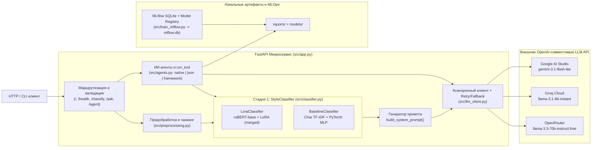
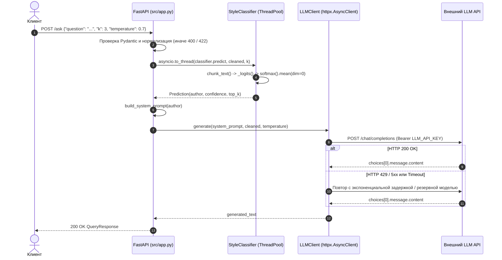

# Техническая документация проекта Literary Style Assistant

**Версия:** 2.0.0  
**Стек технологий:** Python 3.11 / 3.12, PyTorch (CUDA 12.8 / CPU), Hugging Face Transformers & PEFT (LoRA), Scikit-Learn (`HashingVectorizer`, `SGDClassifier`, `TfidfVectorizer`), FAISS (`IndexFlatIP` / PyTorch fallback), FastAPI, Streamlit, Pydantic v2, HTTPX, MLflow (`sqlite:///mlflow.db` + Model Registry + Tracing), LangChain & LangGraph, Ruff, Pytest, Docker

---

## Содержание

1. [Назначение и обзор системы](#1-назначение-и-обзор-системы)
2. [Архитектура и поток управления](#2-архитектура-и-поток-управления)
3. [Модуль предобработки данных (`src/preprocessing.py`)](#3-модуль-предобработки-данных-srcpreprocessingpy)
4. [Подсистема локальной классификации стиля (`src/classifier.py`)](#4-подсистема-локальной-классификации-стиля-srcclassifierpy)
5. [Клиент внешних LLM-провайдеров (`src/llm_client.py`)](#5-клиент-внешних-llm-провайдеров-srcllm_clientpy)
6. [Спецификация REST API и контрактов данных (`src/app.py`, `src/schemas.py`)](#6-спецификация-rest-api-и-контрактов-данных-srcapppy-srcschemaspy)
7. [MLOps-конвейер, Model Registry и CI (`src/train_mlflow.py`, `.github/workflows/ci.yml`)](#7-mlops-конвейер-model-registry-и-ci-srctrain_mlflowpy-githubworkflowsciyml)
8. [ИИ-агенты с инструментами и MLflow Tracing (`src/agents.py`, `agents_comparison.py`)](#8-ии-агенты-с-инструментами-и-mlflow-tracing-srcagentspy-agents_comparisonpy)
9. [Справочник конфигурации и безопасность (`src/config.py`)](#9-справочник-конфигурации-и-безопасность-srcconfigpy)
10. [Артефакты моделей и воспроизводимость обучения (`models/`, `notebooks/`)](#10-артефакты-моделей-и-воспроизводимость-обучения-models-notebooks)
11. [Контейнеризация, развёртывание и эксплуатация](#11-контейнеризация-развёртывание-и-эксплуатация)
12. [Система тестирования и контроля качества (`tests/`)](#12-система-тестирования-и-контроля-качества-tests)

---

## 1. Назначение и обзор системы

**SovTeh Hybrid RAG & AI Plot Assistant** — интеллектуальный микросервис контекстного анализа сюжетов, атрибуции литературного стиля и автономных агентных циклов, объединяющий четыре подсистемы:

1. **Двухэтапный RAG-конвейер (`src/rag.py`, `src/classifier.py`, `data/plots_dataset.csv`):**
   * *Этап 1 (Локальный ML-фильтр):* `HashingVectorizer + SGDClassifier` классифицирует жанровую направленность запроса (7 макро-жанров), а `StyleClassifier` (`ruBERT-base + LoRA` или `PyTorch MLP`) определяет ближайший авторский стиль из **64 русских классиков**.
   * *Этап 2 (Семантический поиск RuBERT + FAISS):* `FAISSVectorIndex` (`faiss.IndexFlatIP` с прозрачным PyTorch CUDA/CPU fallback) выполняет векторный поиск по 132 описаниям сюжетов в оперативной памяти.
2. **Динамический универсальный шлюз LLM API (`src/llm_client.py`, `src/config.py`):** поддержка **любой модели по API** (**Google AI Studio**, **Groq**, **OpenRouter**, **OpenAI**, **Sber GigaChat** или кастомного `LLM_BASE_URL`), автоопрос доступных моделей (`GET /models`), защита от ошибок `404`, сетевой иммунитет (`enforce_network_immunity()` + `trust_env=False`) и кросс-платформенное кодирование (`UTF-8` / `CP1251`).
3. **MLOps-конвейер и CI/CD (`src/train_mlflow.py`, `.github/workflows/ci.yml`):** перебор гиперпараметров в **MLflow (`sqlite:///mlflow.db`)**, регистрация лучшей модели **`literary-style-classifier`** в стадии `Staging` и автопроверка `ruff` + `pytest` в GitHub Actions.
4. **Автономные ИИ-агенты и Streamlit UI (`src/agents.py`, `agents_comparison.py`, `ui.py`, `POST /agent`):** 4 инструмента (`classify_style`, `search_plots`, `author_metrics`, `calc`), 3 архитектуры (`Native`, `JSON`, `LangGraph`) и веб-режимы *RAG-Эксперт*, *Агент-Аналитик*, *Агент-Критик*.

---

## 2. Архитектура и поток управления

### 2.1. Компонентная схема



### 2.2. Последовательность обработки запроса `POST /ask`



### 2.3. Управление жизненным циклом (`lifespan`)

Контекстный менеджер `lifespan(app: FastAPI)` в `src/app.py` гарантирует единоразовую загрузку моделей и чистое освобождение ресурсов:
* **На старте:** читает `get_settings()`, десериализует `models/tfidf_vectorizer.pkl` в `app.state.vectorizer`, загружает классификатор (`LoraClassifier` либо `BaselineClassifier`) в `app.state.classifier`, регистрирует его для инструмента `classify_style` через `set_agent_classifier(classifier)` и открывает пул соединений `httpx.AsyncClient` внутри `LLMClient`.
* **При остановке:** закрывает HTTP-соединения (`await llm_client.aclose()`), освобождает веса (`classifier.close()`), сбрасывает `set_agent_classifier(None)`, запускает `gc.collect()` и `torch.cuda.empty_cache()`.

---

## 3. Модуль предобработки данных (`src/preprocessing.py`)

Модуль используется совместно исследовательскими ноутбуками (`notebooks/`) и продакшен-сервисом (`src/`), исключая расхождение признаков между обучением и инференсом (*train-serving skew*).

| Функция | Сигнатура | Описание |
|---|---|---|
| `extract_author` | `(user_message: str) -> str \| None` | Извлекает имя автора выражениями `AUTHOR_RE_PRIMARY = r"стиле автора ([^\"\r\n]+)"` и `AUTHOR_RE_FALLBACK = r"автора\s+([^\"\r\n]+?)\s*$"`, покрывая 100% из 8 018 записей `train` и блокируя многострочные инъекции (`\r\n`). |
| `clean_text` | `(text: str) -> str` | Декодирует буквальные экранирования (`\r\n`, `\n`, `\t`, `\"`, `\'`), нормализует переносы строк, удаляет управляющие ASCII-символы `[\x00-\x08\x0b\x0c\x0e-\x1f\x7f\u200b\ufeff]`, схлопывает горизонтальные/неразрывные пробелы и пустые строки. |
| `normalize_for_model` | `(text: str) -> str` | Вызывает `clean_text` и схлопывает все пробельные последовательности `\s+` в одиночный пробел. |
| `chunk_text` | `(text: str, chunk_chars: int = 1000, min_chars: int = 200) -> list[str]` | Нарезает текст по границам слов на фрагменты ~`chunk_chars`. Монолитные токены без пробелов разрезаются по `chunk_chars` (защита от DoS), короткий хвост `< min_chars` при наличии предыдущих блоков склеивается с последним фрагментом. |
| `iter_jsonl` | `(path: str \| Path) -> Iterable[dict]` | Потоковое чтение JSON Lines файлов в UTF-8. |
| `parse_record` | `(record: dict) -> tuple[str \| None, str]` | Извлекает пару `(author, assistant_text)` из диалоговой структуры `{"messages": [...]}`. |

---

## 4. Подсистема локальной классификации стиля (`src/classifier.py`)

### 4.1. Базовый абстрактный класс `StyleClassifier`

* Вычисление защищено мьютексом `threading.Lock()` и контекстом `torch.inference_mode()` для безопасного параллельного вызова через `asyncio.to_thread`.
* Для входного текста формируется до `settings.max_chunks` (по умолчанию `16`) фрагментов. Модель выдаёт матрицу сырых логитов $z_m \in \mathbb{R}^{64}$, а итоговые вероятности получаются усреднением `softmax`:
  $$\bar{p} = \frac{1}{M} \sum_{m=1}^{M} \operatorname{softmax}(z_m), \quad \hat{y} = \arg\max_c \bar{p}_c$$

### 4.2. Бэкенд `baseline`: `BaselineClassifier` и `TextClassifier`

* **Векторизация:** `TfidfVectorizer(analyzer="char", lowercase=True, ngram_range=(2, 4), max_features=50000, sublinear_tf=True, dtype=np.float32)` без лемматизации.
* **Архитектура `TextClassifier`:** `nn.Linear(50000, 128) -> nn.ReLU() -> nn.Linear(128, 64)`. Выход возвращает **строго сырые логиты** (без `Softmax`/`LogSoftmax`).
* **Формат чекпоинта `models/baseline_pytorch.pt`:** `model_state_dict`, `optim_state_dict`, `epoch` (`20`), `in_features` (`50000`), `num_classes` (`64`), `classes` (`list[str]`), загружается с `weights_only=True`.

### 4.3. Бэкенд `lora`: `LoraClassifier`

* **Базовый энкодер:** `ai-forever/ruBert-base` (`12` слоёв, `hidden_size=768`, `180 789 632` параметров с головой классификации).
* **Адаптер LoRA:** ранг $r = 16$, масштаб $\alpha = 32$, целевые проекции `query`, `value`, `dense`; на старте вызывается `.merge_and_unload()`, вливающая $\frac{\alpha}{r} B A$ в основные матрицы $W_0$ с нулевым оверхедом на инференсе. На CUDA используется `torch.autocast("cuda", dtype=torch.bfloat16)`.
* **Автоматический откат:** `load_classifier()` при отсутствии `models/lora_classifier/adapter_config.json` логирует предупреждение и переключается на `BaselineClassifier`.

---

## 5. Клиент внешних LLM-провайдеров (`src/llm_client.py`)

### 5.1. Поддерживаемые провайдеры и автоопределение

При `LLM_PROVIDER=auto` провайдер выбирается автоматически по префиксу `LLM_API_KEY`:

| Провайдер | Префикс ключа | Базовый URL (`resolved_base_url`) | Основная модель | Резервные модели (`fallback_models`) |
|---|---|---|---|---|
| **Google AI Studio** (`aistudio`) | `AQ.` или `AIza` | `https://generativelanguage.googleapis.com/v1beta/openai` | `gemini-3.1-flash-lite` | `gemini-flash-lite-latest`, `gemma-4-31b-it` |
| **Groq Cloud** (`groq`) | `gsk_` *(и прочие)* | `https://api.groq.com/openai/v1` | `llama-3.1-8b-instant` | `llama-3.3-70b-versatile` |
| **OpenRouter** (`openrouter`) | `sk-or-` | `https://openrouter.ai/api/v1` | `meta-llama/llama-3.3-70b-instruct:free` | `google/gemini-2.0-flash-exp:free` |
| **OpenAI** (`openai`) | `sk-` | `https://api.openai.com/v1` | `gpt-4o-mini` | `gpt-4.1-mini`, `gpt-3.5-turbo` |
| **Sber GigaChat** (`gigachat`) | `GIGACHAT_CREDENTIALS` | `https://gigachat.devices.sberbank.ru/api/v1` | `GigaChat-2` | `GigaChat-2-Lite`, `GigaChat` |
| **Custom / Local** (`custom`) | *(любой)* | `LLM_BASE_URL` (напр. `http://localhost:11434/v1`) | `LLM_MODEL` | автоопределение через `GET /models` |

### 5.2. Методы `chat()`, `generate()` и разбор `tool_calls`

* `async def chat(messages, tools=None, temperature=0.0) -> LLMChatResult` — универсальный метод для Стадии 2 и агентных циклов: отправляет OpenAI-совместимый `POST /chat/completions` (опционально со схемами `tools`), проверяет `finish_reason` (`"SAFETY"`, `"content_filter"` → `LLMError(502)`), извлекает текст `content` и структурированные `ToolCall(id, name, arguments)` через `_parse_tool_calls()`.
* `async def generate(system_prompt, user_message, temperature=0.7) -> str` — обёртка над `chat()` для Стадии 2, изолирующая пользовательский ввод в тройных кавычках; `SYSTEM_PROMPT_TEMPLATE` дополнительно содержит правила игнорирования prompt-инъекций.

### 5.3. Обработка отказов и ретраи

* Временные ошибки (`HTTP 429, 500, 502, 503, 504`, `httpx.TimeoutException`, сетевые сбои) повторяются с задержкой `1.0 * 2**attempt` и переключением на резервные модели `candidate_models`.
* Ошибки модели `HTTP 400 / 404` при наличии запасных моделей в цепочке немедленно переключают на следующую модель.
* Ошибки авторизации (`HTTP 401 / 403`) завершаются без ретраев (`LLMError`, `502`); отсутствие ключа даёт `LLMError(503)`.

---

## 6. Спецификация REST API и контрактов данных (`src/app.py`, `src/schemas.py`)

Все ответы сериализуются через `UTF8JSONResponse` (`Content-Type: application/json; charset=utf-8`), а `GET /` перенаправляет на `/docs`.

### 6.1. `GET /health`
Проверка состояния сервиса (`HealthResponse`): `{"status": "ok", "model_loaded": true}`.

### 6.2. `POST /classify`
Локальная классификация стиля автора (без внешнего `LLM_API_KEY`).
* **Вход (`QueryRequest`):** `question` (`1..15000`), `k` (`1..10`, по умолчанию `3`), `temperature` (`0.0..2.0`, по умолчанию `0.7`).
* **Ответ `200 OK` (`ClassifyResponse`):** `predicted_author`, `confidence`, `model_name`, `top_authors: list[AuthorScore]`.

### 6.3. `POST /ask`
Полный двухэтапный RAG-конвейер: локальный ML-фильтр жанра/стиля + семантический поиск RuBERT/FAISS + генерация точного ответа через API любой LLM.
* **Вход (`QueryRequest`):** `question`, `k`, `temperature`.
* **Ответ `200 OK` (`QueryResponse`):** `answer`, `sources`, `predicted_author`, `predicted_genre`, `confidence`, `model_name`, `generated_text`.

### 6.4. `POST /agent`
Выполнение многошагового ИИ-агента с инструментами `classify_style`, `search_plots`, `author_metrics`, `calc` либо запуск режимов UI (`mode`: `"Аналитик"` / `"Критик"` / `"RAG"`).

* **Тело запроса (`AgentRequest`):**
  ```json
  {
    "question": "Узнай F1-score Чехова А и Достоевского Ф и вычисли разницу",
    "approach": "native",
    "max_iterations": 6,
    "temperature": 0.0
  }
  ```
  Поля: `question` (`1..15000`), `approach` (`"native" | "json" | "framework"`, по умолчанию `"native"`), `mode` (`str | None`), `max_iterations` (`1..12`, по умолчанию `6`), `temperature` (`0.0..2.0`, по умолчанию `0.0`).
* **Ответ `200 OK` (`AgentResponse`):**
  ```json
  {
    "approach": "native",
    "answer": "F1-score Достоевского Ф — 0.9394, Чехова А — 0.8934, разница — 0.046.",
    "iterations": 3,
    "steps": [
      {"step": 1, "tool": "author_metrics", "args": {"author_query": "Чехов А"}, "result": "...", "raw": null},
      {"step": 1, "tool": "author_metrics", "args": {"author_query": "Достоевский Ф"}, "result": "...", "raw": null},
      {"step": 2, "tool": "calc", "args": {"expression": "0.9394 - 0.8934"}, "result": "0.046", "raw": null}
    ]
  }
  ```

### 6.5. Коды ошибок API

| HTTP-код | Причина возникновения | Тело ответа |
|---|---|---|
| `400 Bad Request` | `question == ""` или состоит из пробелов/управляющих символов | `{"detail": "Пустой вопрос"}` |
| `422 Unprocessable Entity` | Нарушение ограничений Pydantic (`question`, `k`, `temperature`, `approach`, `max_iterations`) | Список ошибок Pydantic |
| `502 Bad Gateway` | Ошибка авторизации `401/403`, safety-блокировка или исчерпание ретраев LLM API | `{"detail": "Ошибка внешнего LLM API: ..."}` |
| `503 Service Unavailable` | Не задан `LLM_API_KEY` (для `/ask` или `/agent`) либо не загружен локальный классификатор | `{"detail": "..."}` |
| `504 Gateway Timeout` | Тайм-аут `LLM_TIMEOUT` на всех попытках обращения к LLM API | `{"detail": "Ошибка внешнего LLM API: тайм-аут..."}` |

---

## 7. MLOps-конвейер, Model Registry и CI (`src/train_mlflow.py`, `.github/workflows/ci.yml`)

### 7.1. Эксперименты и реестр моделей MLflow (`src/train_mlflow.py`)

* **Хранилище и эксперимент:** локальная БД `sqlite:///mlflow.db`, эксперимент `doc-classifier`, фиксированный seed `42`.
* **Источник данных (`load_training_split`):** читает `data/processed/chunks_train.parquet` с разбиением по группам произведений `GroupShuffleSplit(test_size=0.2)` (чтобы фрагменты одной книги не пересекались между train и test); при отсутствии `chunks_train.parquet` или флаге `--synthetic` строит детерминированный разреженный датасет той же размерности `50 000` признаков (`data_source="synthetic_fallback"`).
* **Сетки гиперпараметров:**
  * полная (`DEFAULT_GRID`, 9 запусков): `lr ∈ {0.0001, 0.001, 0.01}` × `epochs ∈ {5, 10, 20}`;
  * быстрая (`QUICK_GRID`, `--quick`, 4 запуска): `(0.0001, 5), (0.0005, 5), (0.001, 5), (0.01, 5)`.
* **Логирование в `train_once()`:**
  * **Параметры:** `lr`, `epochs`, `batch_size`, `in_features`, `num_classes`, `optimizer="Adam"`.
  * **Теги:** `assignment="mlops-task-1"`, `model_family="TextClassifier_MLP"`, `data_source`.
  * **Метрики:** `train_loss` (по шагам эпох), `test_accuracy`, `test_f1_macro`, `train_time_sec`.
  * **Артефакты:** `config/run_config.json`, сравнительный график метрик `charts/accuracy_chart.png` и модель PyTorch через `mlflow.pytorch.log_model` с сигнатурой `infer_signature` и примером входа `input_example`.
* **Model Registry (`register_best_model_to_staging`):** выбирает лучший запуск по `(test_accuracy, test_f1_macro)`, регистрирует модель под именем **`literary-style-classifier`**, назначает алиас `@staging`, тег `stage="Staging"` и выполняет перевод стадии в **`Staging`**.

### 7.2. Непрерывная интеграция (`.github/workflows/ci.yml`)

При каждом `push` и `pull_request` в ветку `main` запускается job `lint-and-test` на `ubuntu-latest` с Python `3.12`:
1. Установка CPU-сборки PyTorch и `requirements.txt`.
2. Статический анализ: `ruff check src tests agents_comparison.py --line-length 105`.
3. Автономный прогон тестов: `CLASSIFIER_BACKEND=baseline pytest tests -v -k "not test_live_e2e and not test_baseline_and_lora"`.

---

## 8. ИИ-агенты с инструментами и MLflow Tracing (`src/agents.py`, `agents_comparison.py`)

### 8.1. Инструменты и безопасность вызова

Все 3 инструмента зарегистрированы в `TOOLS` и описаны строгими Pydantic-схемами с `ConfigDict(extra="forbid")`:

| Инструмент | Схема аргументов | Назначение |
|---|---|---|
| `classify_style` | `ClassifyStyleArgs(text: str)` | Вызывает локальный `StyleClassifier.predict(text, k=3)` и возвращает JSON с `predicted_author`, `confidence`, `model_name`, `top_3`. |
| `author_metrics` | `AuthorMetricsArgs(author_query: str)` | Читает `reports/lora_per_class_report.csv`, `metrics_lora.json`, `metrics_baseline.json` и `labels.json`; возвращает метрики автора или сводку `'overall'`. |
| `calc` | `CalcArgs(expression: str)` | Безопасный AST-вычислитель (без `eval`): поддерживает только числа и бинарные/унарные `+`, `-`, `*`, `/`, скобки, перехватывает деление на ноль. |

Обёртка `run_tool(name, args)` проверяет существование инструмента, валидирует входные аргументы через Pydantic и перехватывает любые ошибки, возвращая агенту диагностическую строку вместо падения цикла.

### 8.2. Три архитектуры агентных циклов и наблюдаемость

1. **Native Tool Calling (`run_native_agent[_async]`):** передаёт автогенерированные OpenAI JSON-схемы `TOOL_SCHEMAS` в `LLMClient.chat(..., tools=TOOL_SCHEMAS)`, сохраняет сообщения `assistant` с `tool_calls` и возвращает ответы инструментов в сообщениях `role="tool"` с `tool_call_id`.
2. **Ручной JSON-цикл (`run_json_agent[_async]`):** работает с любыми моделями через `JSON_SYSTEM_PROMPT`; парсер `extract_json()` очищает markdown-блоки и извлекает первый JSON через `JSONDecoder.raw_decode()`. Ошибки парсинга или неизвестные действия передаются в историю для самоисправления.
3. **Фреймворк LangGraph (`run_framework_agent[_async]`):** строит граф через `langgraph.prebuilt.create_react_agent` с `ChatOpenAI`, инструментами `@tool` и защитным лимитом `recursion_limit = max_iterations * 2 + 2` (перехват `GraphRecursionError`).

**Трассировка:** все циклы поддерживают логирование шагов в `logger`/`AgentStepTrace` и опциональный **MLflow Tracing** (`enable_mlflow_trace=True`, эксперимент `doc-classifier-agents`): корневые спаны `AGENT`, дочерние спаны `LLM` и `TOOL` (`_execute_traced_tool`), а для LangGraph — `mlflow.langchain.autolog()`. Скрипт `agents_comparison.py` сравнивает все три подхода на одном составном запросе (как с реальным LLM API, так и с флагами `--mock --trace`).

---

## 9. Справочник конфигурации и безопасность (`src/config.py`)

| Переменная | Тип | По умолчанию | Описание |
|---|---|---|---|
| `LLM_API_KEY` | `SecretStr \| None` | `None` | Ключ Google AI Studio, Groq Cloud или OpenRouter |
| `LLM_PROVIDER` | `auto\|groq\|openrouter\|aistudio` | `auto` | Явный провайдер или автоопределение по префиксу |
| `LLM_BASE_URL` / `LLM_MODEL` | `str \| None` | `None` | Переопределение URL API и имени модели |
| `LLM_TIMEOUT` | `float` | `25.0` | Тайм-аут одного HTTP-запроса (сек) |
| `LLM_MAX_TOKENS` | `int` | `1024` | Лимит токенов генерации (`16..8192`) |
| `LLM_MAX_RETRIES` | `int` | `2` | Число ретраев при временных сбоях (`0..5`) |
| `CLASSIFIER_BACKEND` | `lora\|baseline` | `lora` | Выбор локальной модели классификации |
| `MODELS_DIR` | `Path` | `<root>/models` | Директория артефактов моделей |
| `DEVICE` | `auto\|cpu\|cuda` | `auto` | Устройство вычислений PyTorch |
| `CHUNK_CHARS` / `MAX_CHUNKS` | `int` / `int` | `1000` / `16` | Длина фрагмента и предел фрагментов на запрос |

* Секрет `llm_api_key` обёрнут в `SecretStr`, исключён из Git (`.gitignore`) и образа Docker (`.dockerignore`).
* Инструмент `calc` работает поверх белого списка AST-узлов (`ast.Constant`, `+`, `-`, `*`, `/`), исключая произвольное выполнение кода.

---

## 10. Артефакты моделей и воспроизводимость обучения (`models/`, `notebooks/`)

| Путь | Назначение | Размер |
|---|---|---:|
| `models/tfidf_vectorizer.pkl` | Посимвольный `TfidfVectorizer` (`(2,4)`, `50 000` признаков, `float32`) | `1.56 МБ` |
| `models/label_encoder.pkl` | `LabelEncoder` на `64` автора | `2 КБ` |
| `models/baseline_pytorch.pt` | Чекпоинт `TextClassifier` (`model_state_dict`, `optim_state_dict`, метаданные) | `73.35 МБ` |
| `models/lora_classifier/adapter_model.safetensors` | Веса LoRA-адаптера и головы классификации `ruBert-base` | `9.30 МБ` |
| `models/lora_classifier/adapter_config.json` | Параметры PEFT (`r=16`, `lora_alpha=32`, `target_modules`) | `1 КБ` |
| `models/lora_classifier/labels.json` | Список `64` классов, `max_length=256`, `base_model` | `2 КБ` |
| `models/lora_classifier/tokenizer.json` | Быстрый WordPiece-токенизатор | `3.54 МБ` |

Конвейер обучения в ноутбуках:
1. `notebooks/01_eda_and_cleaning.ipynb` → `data/processed/parsed_*.parquet`, `chunks_*.parquet`
2. `notebooks/02_tfidf_experiments.ipynb` → `models/tfidf_vectorizer.pkl`, `models/label_encoder.pkl`
3. `notebooks/03_pytorch_baseline.ipynb` → `models/baseline_pytorch.pt`
4. `notebooks/04_lora_finetuning.ipynb` → `models/lora_classifier/`

---

## 11. Контейнеризация, развёртывание и эксплуатация

### 11.1. Docker (`Dockerfile`)

* Базовый образ `python:3.11-slim`, установка CPU-версии PyTorch (`--index-url https://download.pytorch.org/whl/cpu`) перед `requirements.txt`.
* Предварительное скачивание `ai-forever/ruBert-base` в слой образа при сборке.
* Непривилегированный пользователь `appuser` (UID `1000`), копирование `src/`, `models/` и `reports/`.
* Встроенный `HEALTHCHECK` на `http://localhost:8000/health` каждые 30 секунд.

```bash
docker build -t literary-style-assistant .
docker run --rm -p 8000:8000 -e LLM_API_KEY="your_api_key_here" literary-style-assistant
```

### 11.2. Рекомендации по выбору бэкенда под нагрузку

* **`CLASSIFIER_BACKEND=lora` (по умолчанию):** оптимален при наличии GPU (`8.13 мс` на запрос) или умеренном RPS на CPU (`84.48 мс`), даёт лучший Macro-F1 на полных документах (**`98.53 %`**).
* **`CLASSIFIER_BACKEND=baseline`:** оптимален для легковесных CPU-серверов (`1.99 мс` на CPU) и быстрых тестов без скачивания трансформера.

---

## 12. Система тестирования и контроля качества (`tests/`)

Пакет включает **8 модулей (`44` теста)**, проверяющих предобработку, кодировки UTF-8/CP1251, RAG-поиск, сетевую изоляцию, конфигурацию и автопоиск моделей LLM, классификаторы, безопасность, агентные циклы, MLflow Registry и FastAPI:

| Модуль | Проверяемая функциональность |
|---|---|
| `tests/test_preprocessing.py` | Все 4 шаблона извлечения автора, очистка битых экранирований и невидимых символов, нормализация, нарезка `chunk_text`, чтение JSONL. |
| `tests/test_config_and_llm.py` | Автоопределение провайдеров (`AI Studio`, `Groq`, `OpenRouter`, `OpenAI`, `GigaChat`), сетевой иммунитет (`enforce_network_immunity`), динамический `discover_models()` и восстановление от `404`, ретраи и обработка ошибок `504`/`502`. |
| `tests/test_rag.py` | Датасет `data/plots_dataset.csv` (все 64 автора), чтение `UTF-8` / `CP1251`, `HashingVectorizer + SGDClassifier`, `FAISSVectorIndex`, точный RAG-поиск и high-rating fallback, режимы `Аналитик` и `Критик`. |
| `tests/test_classifiers.py` | Отсутствие `Softmax` внутри `TextClassifier`, прохождение градиентов, целостность артефактов в `models/`, инференс `BaselineClassifier` и `LoraClassifier`. |
| `tests/test_adversarial_and_robustness.py` | Защита от падения на невидимых/управляющих символах (`400` вместо `500`), блокировка многострочных инъекций в regex автора, принудительная нарезка длинных слов без пробелов, лимит `15000` символов (`422`) и OOD-вводы. |
| `tests/test_agents.py` | Все 4 инструмента (`classify_style`, `search_plots`, `author_metrics`, `calc`), `run_tool` и Pydantic-валидация, `extract_json`, циклы Native / JSON / LangGraph (ошибки и `max_iterations`), `LLMClient.chat(tools=...)` и эндпоинт `POST /agent` (включая UI-режимы `Аналитик`/`Критик`). |
| `tests/test_mlflow.py` | Прогон серии экспериментов в `sqlite:///`, логирование параметров/метрик/тегов/артефактов (`config`, `charts`) и регистрация лучшей модели в `Staging`. |
| `tests/test_api_and_e2e.py` | Жизненный цикл `lifespan`, `/health`, `/classify`, `/ask` (включая `UTF-8` заголовок и RAG `sources`), проброс `504`/`503` и живой E2E-тест `POST /ask`. |

Команды проверки качества (совпадают с CI):

```bash
ruff check src tests agents_comparison.py ui.py test_request.py --line-length 105
CLASSIFIER_BACKEND=baseline pytest tests -v --cov=src --cov-report=term-missing -k "not test_live_e2e and not test_baseline_and_lora"
```
