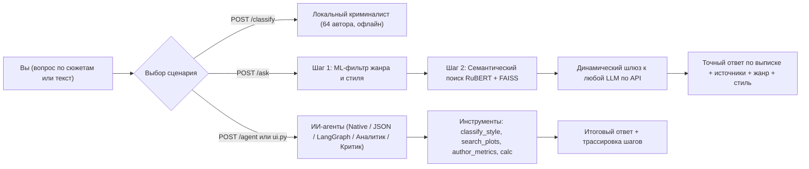

# Простое объяснение проекта и подробная инструкция к пользованию

Этот документ состоит из двух частей:
1. **Часть 1 — Упрощённое объяснение («на пальцах»):** что делает проект, зачем он устроен именно так, какие нейросети, MLOps-инструменты и ИИ-агенты работают внутри и что лежит в каждой папке.
2. **Часть 2 — Подробная инструкция пользователя:** как установить зависимости, настроить ключ, запустить сервер и проверять эндпоинты, запускать MLOps-эксперименты в MLflow, сравнивать три архитектуры ИИ-агентов, прогонять тесты и решать типовые неполадки.

---

## Часть 1. Упрощённое объяснение: как работает и что содержит проект

### 1.1. Главная идея в двух словах

Представьте интеллектуальную систему анализа сюжетов и литературных текстов, где роли чётко разделены:
1. **Локальный ML-фильтр жанра и стиля** (работает **локально** на вашем компьютере, без интернета). Мгновенно определяет жанровую направленность запроса через `HashingVectorizer + SGDClassifier` (7 макро-жанров) и ближайший авторский стиль из **64 русских классиков** (`ruBERT-base + LoRA` или `PyTorch MLP`).
2. **Семантический поиск (RuBERT + FAISS) по базе сюжетов (`data/plots_dataset.csv`)**: векторный индекс находит наиболее подходящие описания произведений (132 сюжета по всем 64 авторам) с аппаратным ускорением на **NVIDIA CUDA GPU** или CPU. При отсутствии точных совпадений система честно предупреждает об этом и рекомендует топ по рейтингу.
3. **Универсальный шлюз к любой LLM по API (`src/llm_client.py`)**: работает с Google Gemini (AI Studio), Groq Cloud, OpenRouter, OpenAI, Sber GigaChat или любым кастомным URL (`LLM_BASE_URL` + `LLM_MODEL`). При старте автоматически опрашивает доступные модели (`GET /models`) и изолирует процесс Python от системных прокси/VPN Windows (`enforce_network_immunity()`).
4. **ИИ-агенты и веб-интерфейс Streamlit (`src/agents.py`, `ui.py`)**: 4 инструмента (`classify_style`, `search_plots`, `author_metrics`, `calc`), 3 архитектуры циклов (`Native`, `JSON`, `LangGraph`), режимы веб-UI (*RAG-Эксперт*, *Агент-Аналитик*, *Агент-Критик*) и MLOps-конвейер в **MLflow**.



---

### 1.2. Зачем две стадии, если можно просто спросить большую нейросеть напрямую?

На практике двухстадийная схема решает сразу три проблемы:
* **Точность на редких авторах.** В датасете проекта **64 писателя** — среди них не только школьная классика, но и авторы XIX–XX веков со специфическим слогом: Вельтман, Нарежный, Загоскин, Помяловский, Слепцов, Вагинов, Чарская и др. Обычный чат-бот почти всегда «сваливается» к 5 самым известным фамилиям, тогда как локальная модель обучена на **110 285 реальных отрывках** всех 64 авторов и угадывает автора целого текста с точностью **более 99%**.
* **Скорость и автономность проверки.** Первая стадия работает локально на GPU или CPU за миллисекунды и не расходует платные токены внешнего API. Режим `/classify` можно вызывать без интернета и без API-ключа.
* **Чистота генерации.** Когда облачная модель заранее получает точное имя автора в системной инструкции (с защитой от prompt-инъекций), она сразу фокусируется на художественной стилизации.

> [!NOTE]
> Полный список всех **64 поддерживаемых авторов** хранится в файле [labels.json](../models/lora_classifier/labels.json) — ни один автор из исходного датасета не был удалён.

---

### 1.3. Как компьютер узнаёт авторский почерк? Два локальных «мозга» внутри проекта

В проекте обучены и сохранены сразу **две разные локальные нейросети**. Между ними можно переключаться одной переменной окружения (`CLASSIFIER_BACKEND`).

#### Вариант 1: `lora` (`rubert-base-lora`) — включён по умолчанию
* **Как работает простыми словами:** За основу взята русскоязычная модель-трансформер `ai-forever/ruBert-base` (~180.8M параметров с головой классификации). Чтобы не переобучать всю сеть целиком, применён метод **LoRA** — к внутренним слоям добавлены компактные обучаемые адаптеры (обучалось всего **1.35%** весов).
* **Сколько весит:** Обученный адаптер в папке `models/lora_classifier/` занимает **9.30 МБ**. При старте сервера он автоматически сливается с базовым `ruBERT-base` методом `merge_and_unload()` без накладных расходов на инференсе.
* **В чём сильна:** Лучше всех распознаёт контекст, лексику и редких авторов на целых произведениях (**99.15%** Accuracy и **98.53%** Macro-F1 на тесте).

#### Вариант 2: `baseline` (`pytorch-mlp-char-tfidf`) — сверхбыстрый нейросетевой вариант
* **Как работает простыми словами:** Модель не приводит слова к начальной форме (без лемматизации), а анализирует скользящие окна из **2, 3 и 4 символов подряд** (буквы, пробелы, пунктуация) и считает 50 000 самых характерных комбинаций: например, `", а "`, `" — "`, `"-с,"`, `"ться"`. Поверх вектора работает двухслойная нейросеть `TextClassifier` на PyTorch.
* **Почему без лемматизации:** Если привести *«милостивый государь-с, позвольте-ка...»* к словарным основам, сотрутся частицы *«-с»*, *«-ка»*, тире и авторские окончания — то есть исчезнет сам почерк писателя. Эксперименты в [02_tfidf_experiments.ipynb](../notebooks/02_tfidf_experiments.ipynb) подтвердили преимущество сырых символьных n-грамм по скорости и точности.
* **В чём сильна:** Молниеносная скорость (**~1.34 мс** на GPU, **~1.99 мс** на CPU) и высокая точность на отдельных отрывках по 1000 символов (**94.35%** Accuracy) при минимальном потреблении памяти.

| Характеристика | `lora` (`ruBERT-base + LoRA`) — по умолчанию | `baseline` (`char TF-IDF + PyTorch MLP`) |
| :--- | :--- | :--- |
| **Принцип анализа** | Смысл, контекст и словесные конструкции (трансформер) | Пунктуация, суффиксы, буквенные сочетания по 2–4 символа |
| **Точность на целых произведениях (Macro-F1)** | **98.53%** (лучше на редких авторах) | 96.85% |
| **Точность на фрагментах ~1000 символов (Accuracy)** | 91.72% | **94.35%** |
| **Скорость ответа на процессоре (CPU)** | ~84.5 мс | **~1.99 мс** |
| **Когда выбирать** | Основной режим (особенно при наличии NVIDIA GPU) | Лёгкий CPU-сервер или минимальная задержка |

---

### 1.4. Зачем резать длинный текст на фрагменты по ~1000 символов?

Если отправить в сервис длинный отрывок (например, 5–10 тысяч знаков), программа не обрезает хвост текста, а использует **голосование фрагментов (чанков)**:
1. Модуль [preprocessing.py](../src/preprocessing.py) очищает текст от невидимых и управляющих символов и нарезает его строго **по границам слов** на фрагменты ~1000 символов (максимум 16 фрагментов за запрос).
2. Нейросеть оценивает **каждый фрагмент отдельно** и переводит логиты в вероятности через `softmax`.
3. Вероятности по всем фрагментам **усредняются**, давая устойчивое итоговое предсказание автора.

---

### 1.5. Зачем нужны MLOps (MLflow) и три архитектуры ИИ-агентов?

#### Зачем MLOps и MLflow (`src/train_mlflow.py`)?
Чтобы обучение моделей не превращалось в разрозненные запуски вручную с потерей лучших настроек:
* скрипт `src/train_mlflow.py` запускает серию экспериментов с разными `lr` и `epochs` и сохраняет всё в локальную базу `sqlite:///mlflow.db` (эксперимент `doc-classifier`);
* в каждом запуске фиксируются параметры, метрики (`train_loss`, `test_accuracy`, `test_f1_macro`), теги, JSON-конфиг, график сравнения `accuracy_chart.png` и сама PyTorch-модель с сигнатурой входа/выхода;
* лучшая версия автоматически регистрируется в **MLflow Model Registry** под именем `literary-style-classifier` и переводится в стадию **`Staging`**.

#### Зачем ИИ-агенты (`src/agents.py` и `agents_comparison.py`)?
Обычный чат-бот отвечает «из памяти» и может ошибиться в статистике или арифметике. ИИ-агент получает **три реальных инструмента** и сам строит цепочку шагов:
1. **`classify_style`** — запускает наш локальный PyTorch/LoRA классификатор на переданном отрывке текста.
2. **`author_metrics`** — достаёт точные `precision`, `recall`, `f1_score` и `support` из файлов отчётов в `reports/`.
3. **`calc`** — безопасно вычисляет арифметические выражения (`+`, `-`, `*`, `/`, скобки) через AST-парсер.

Все три архитектуры решают одну и ту же задачу по-разному:
* **`native`** — передаёт в LLM JSON-схемы инструментов (`TOOL_SCHEMAS`) и обменивается структурированными `tool_calls` + `tool_call_id`.
* **`json`** — работает с любой текстовой LLM без поддержки native tool calling: просит модель на каждом шаге возвращать строго один JSON `{"action": ..., "input": ...}`.
* **`framework`** — использует готовый оркестратор ReAct-агента `langgraph.prebuilt.create_react_agent` с автологированием в MLflow (`doc-classifier-agents`).

---

### 1.6. Карта всех папок и файлов проекта

| Папка / файл | Что там лежит простыми словами | Нужна ли для запуска сервера? |
| :--- | :--- | :--- |
| `src/` | **Боевой код проекта:** FastAPI (`app.py`), семантический RAG (`rag.py`), предобработка и сетевой иммунитет (`preprocessing.py`), классификаторы (`classifier.py`), шлюз LLM (`llm_client.py`), конфиг (`config.py`), схемы (`schemas.py`), 4-инструментные агенты (`agents.py`) и MLOps (`train_mlflow.py`). | **Да, обязательно** |
| `data/plots_dataset.csv` | **Подготовленный датасет сюжетов (132 произведения по всем 64 авторам)** для семантического RAG-поиска и аналитики. | **Да, обязательно** |
| `ui.py` и `test_request.py` | **Веб-интерфейс Streamlit** (режимы RAG, Аналитик, Критик) и изолированный тестовый клиент для консоли. | Опционально (для UI/тестов) |
| `agents_comparison.py` | **Скрипт сравнения 3 агентных циклов** в терминале (поддерживает живой и `--mock` режим, а также `--trace` в MLflow). | Нет (запускается для демонстрации) |
| `.github/workflows/ci.yml` | **Конвейер CI в GitHub Actions:** автоматически запускает `ruff` и `pytest` при каждом `push` / `pull_request` в `main`. | Нет (работает на GitHub) |
| `models/` | **Обученные веса моделей:** `tfidf_vectorizer.pkl`, `label_encoder.pkl`, `baseline_pytorch.pt` и `lora_classifier/`. | **Да, обязательно** |
| `.env` | **Секретный файл с ключом `LLM_API_KEY` (любой модели по API).** Исключён из Git и Docker. | **Да** (для `/ask` и живого `/agent`) |
| `notebooks/` | **Исследовательская лаборатория (4 ноутбука Jupyter):** очистка датасета, эксперименты TF-IDF, обучение Baseline и LoRA. | Нет (для изучения / переобучения) |
| `data/raw` и `data/processed` | **Сырые и обработанные Parquet-файлы** (исключены из Git и Docker). | Нет (только для ноутбуков) |
| `reports/` | **Метрики и графики обучения:** JSON/CSV-отчёты по моделям и авторам (используются в том числе инструментом `author_metrics`). | **Да** (для инструмента `author_metrics`) |
| `tests/` | **Автоматические тесты (8 модулей, 44 теста):** проверка предобработки, RAG, динамического шлюза LLM, классификаторов, стресс-устойчивости, агентов, MLflow Registry и FastAPI E2E. | Нет (для самопроверки) |
| `docs/` и `REPORT.md` | **Документация и аналитический отчёт.** | Нет |
| `Dockerfile` | **Сборка изолированного Docker-контейнера** на CPU PyTorch с предзагруженным `ruBert-base`. | Только при запуске в Docker |

---

## Часть 2. Подробная пошаговая инструкция к пользованию

### Шаг 1. Подготовка окружения и установка

**Системные требования:**
* ОС: Windows 10/11, Linux или macOS.
* Python: **3.11** или **3.12**.
* ОЗУ: от **4 ГБ** для `lora` (от **1.5 ГБ** для `baseline`).
* Видеокарта NVIDIA необязательна — сервис автоматически работает и на GPU (CUDA), и на обычном CPU.

**Linux / macOS / WSL:**
```bash
cd SovTeh
python3 -m venv .venv
source .venv/bin/activate
# Для CPU (быстрая лёгкая установка):
pip install torch --index-url https://download.pytorch.org/whl/cpu
pip install -r requirements.txt
```

**Windows PowerShell:**
```powershell
cd SovTeh
python -m venv .venv
# Если есть видеокарта NVIDIA (CUDA 12.8):
.venv\Scripts\pip install torch --index-url https://download.pytorch.org/whl/cu128
# Или без видеокарты (CPU):
# .venv\Scripts\pip install torch --index-url https://download.pytorch.org/whl/cpu
.venv\Scripts\pip install -r requirements.txt
```

---

### Шаг 2. Настройка API-ключа любой LLM (`.env`)

Для генерации ответов в `/ask` и живого режима агентов подходит **любая модель по API**: достаточно указать ключ провайдера (сервис определяет провайдера по префиксу при `LLM_PROVIDER=auto`, либо поддерживает явные `LLM_BASE_URL` и `LLM_MODEL`):

1. **Google AI Studio** — `AQ....` или `AIza...` (или `GEMINI_API_KEY`) → автопоиск моделей Gemini.
2. **Groq Cloud** — `gsk_...` (или `GROQ_API_KEY`) → `llama-3.1-8b-instant` / доступные модели тарифа.
3. **OpenRouter** — `sk-or-...` (или `OPENROUTER_API_KEY`) → любые облачные/бесплатные модели.
4. **OpenAI / DeepSeek / Ollama / vLLM** — `sk-...` (или `OPENAI_API_KEY` + опционально `LLM_BASE_URL` и `LLM_MODEL`).
5. **Sber GigaChat** — `GIGACHAT_CREDENTIALS` (с автообменом OAuth и изоляцией прокси Windows).

Скопируйте шаблон [.env.example](../.env.example) в файл `.env` и впишите свой ключ:
```ini
LLM_API_KEY=ваш_ключ_без_кавычек
LLM_PROVIDER=auto
LLM_AUTO_DISCOVER_MODELS=true
BYPASS_SYSTEM_PROXY=true
CLASSIFIER_BACKEND=lora
DEVICE=auto
```

#### Основные переменные окружения

| Переменная | По умолчанию | Описание |
| :--- | :--- | :--- |
| `LLM_API_KEY` | *(пусто)* | Секретный ключ для генерации и живых агентов (для `/classify` и `--mock` не нужен). |
| `LLM_PROVIDER` | `auto` | `auto`, `aistudio`, `groq`, `openrouter`. |
| `CLASSIFIER_BACKEND` | `lora` | `lora` (`ruBERT-base + LoRA`) или `baseline` (`char TF-IDF + PyTorch MLP`). |
| `DEVICE` | `auto` | `auto`, `cuda`, `cpu`. |
| `LLM_MODEL` / `LLM_BASE_URL` | *(по провайдеру)* | Ручное переопределение модели или URL (например, локальный Ollama). |
| `LLM_TIMEOUT` / `LLM_MAX_RETRIES` | `25.0` / `2` | Тайм-аут запроса в секундах и число ретраев с backoff. |
| `CHUNK_CHARS` / `MAX_CHUNKS` | `1000` / `16` | Размер фрагмента текста и лимит числа фрагментов на запрос. |

> [!WARNING]
> Никогда не вписывайте `LLM_API_KEY` в исходный код или `Dockerfile` — используйте только файл `.env` (он в `.gitignore` и `.dockerignore`) либо передавайте через `-e LLM_API_KEY=...` при запуске контейнера.

---

### Шаг 3. Запуск и остановка веб-сервера FastAPI

**Linux / macOS / WSL:**
```bash
.venv/bin/uvicorn src.app:app --host 0.0.0.0 --port 8000
```

**Windows PowerShell:**
```powershell
.venv\Scripts\uvicorn.exe src.app:app --host 0.0.0.0 --port 8000
```

* При первом запуске с `CLASSIFIER_BACKEND=lora` (если в `models/` нет локальной папки `rubert_base`) скачается энкодер `ai-forever/ruBert-base` в кэш Hugging Face.
* После сообщения `Uvicorn running on http://0.0.0.0:8000` сервер готов принимать запросы. Остановка — `Ctrl + C` (память очищается автоматически в `lifespan`).

---

### Шаг 4. Использование REST API (четыре эндпоинта)

#### Вариант А. Через браузер (Swagger UI)
Откройте **http://localhost:8000/docs** (корневой адрес `/` автоматически перенаправляет сюда). Доступны 4 маршрута:
1. `GET /health` — проверка готовности сервиса и загрузки локального классификатора.
2. `POST /classify` — только определить автора и `top_authors` (**работает офлайн без `LLM_API_KEY`**).
3. `POST /ask` — определить автора и сгенерировать текст в его стиле через внешнюю LLM.
4. `POST /agent` — запустить многошагового ИИ-агента (`approach`: `"native"`, `"json"` или `"framework"`).

Нажмите нужный маршрут → **«Try it out»** → вставьте JSON → **«Execute»**.

#### Вариант Б. Через `curl`
```bash
# 1. Проверка здоровья
curl http://localhost:8000/health

# 2. Локальная классификация стиля (без API-ключа)
curl -X POST http://localhost:8000/classify \
  -H "Content-Type: application/json" \
  -d '{"question": "В саду за старой усадьбой тихо осыпались липы; доктор пил чай на террасе.", "k": 5}'

# 3. Классификация + стилизованная генерация
curl -X POST http://localhost:8000/ask \
  -H "Content-Type: application/json" \
  -d '{"question": "Какая прекрасная ночь над Невой...", "k": 3, "temperature": 0.7}'

# 4. Многошаговый ИИ-агент
curl -X POST http://localhost:8000/agent \
  -H "Content-Type: application/json" \
  -d '{"question": "Узнай F1-score Чехова и Достоевского и вычисли разницу", "approach": "native", "max_iterations": 6}'
```

#### Вариант В. Через Windows PowerShell (с корректной UTF-8 кириллицей)
```powershell
$body = @{
    question       = "Узнай F1-score Чехова А и Достоевского Ф и вычисли их разницу"
    approach       = "native"
    max_iterations = 6
} | ConvertTo-Json

Invoke-RestMethod -Method Post -Uri "http://localhost:8000/agent" `
    -ContentType "application/json; charset=utf-8" `
    -Body ([System.Text.Encoding]::UTF8.GetBytes($body)) | ConvertTo-Json -Depth 5
```

#### Вариант Г. Из Python-скрипта
```python
import httpx

resp = httpx.post(
    "http://localhost:8000/ask",
    json={"question": "Расскажи о прогулке по осенней Москве.", "k": 3, "temperature": 0.7},
    timeout=30.0,
)
data = resp.json()
print(f"{data['predicted_author']} ({data['confidence']:.1%}) -> {data['generated_text']}")
```

---

### Шаг 5. Запуск MLOps-конвейера и просмотр MLflow UI

Запустите серию экспериментов для обучения PyTorch-классификатора `TextClassifier`:
```bash
# Быстрая серия из 4 запусков (использует parquet или synthetic fallback, если data/processed/ нет):
python -m src.train_mlflow --quick

# Принудительный автономный прогон на синтетических данных (занимает несколько секунд):
python -m src.train_mlflow --quick --synthetic

# Полная сетка (9 запусков: lr in [0.0001, 0.001, 0.01] x epochs in [5, 10, 20]):
python -m src.train_mlflow
```

Откройте веб-интерфейс MLflow:
```bash
mlflow ui --backend-store-uri sqlite:///mlflow.db
```
Перейдите по адресу **`http://127.0.0.1:5000`**:
* **Experiments → `doc-classifier`**: таблица запусков с параметрами (`lr`, `epochs`), кривыми `train_loss`, итоговыми метриками (`test_accuracy`, `test_f1_macro`), тегами и вкладкой **Artifacts** (`config/run_config.json`, `charts/accuracy_chart.png`, папка `model/`).
* **Models → `literary-style-classifier`**: зарегистрированная лучшая версия модели с алиасом **`@staging`** и тегом **`stage=Staging`**.

---

### Шаг 6. Сравнение трёх архитектур ИИ-агентов

Скрипт `agents_comparison.py` запускает составной запрос по очереди через **Native Tool Calling**, **JSON-цикл** и **LangGraph**:
```bash
# Автономная демонстрация (замоканная LLM + реальный локальный классификатор и калькулятор + MLflow Traces):
python agents_comparison.py --mock --trace

# Реальный прогон через внешний LLM API из .env + запись MLflow Traces:
python agents_comparison.py --trace

# Свой составной вопрос:
python agents_comparison.py --query "Определи стиль отрывка 'Ночь над Невой' и найди F1-score этого автора" --trace
```
После флага `--trace` отчёт по каждому шагу (`AGENT` → `LLM` → `TOOL`) можно посмотреть в `mlflow ui --backend-store-uri sqlite:///mlflow.db` во вкладке **Traces** эксперимента `doc-classifier-agents`.

---

### Шаг 7. Запуск автотестов, линтера и воспроизведение ноутбуков

```bash
# Линтер Ruff (так же запускается в GitHub Actions CI):
ruff check src tests agents_comparison.py ui.py test_request.py --line-length 105

# Автономные тесты без внешнего API-ключа и без тяжёлой загрузки LoRA:
CLASSIFIER_BACKEND=baseline pytest tests -v --cov=src --cov-report=term-missing -k "not test_live_e2e and not test_baseline_and_lora"

# Полный прогон всех 44 тестов (потребуется ключ в .env для live E2E и модель ruBERT для LoRA-теста):
pytest tests -v --cov=src --cov-report=term-missing
```

Исследовательские ноутбуки в `notebooks/` запускаются последовательно (ядро `.venv`):
1. [01_eda_and_cleaning.ipynb](../notebooks/01_eda_and_cleaning.ipynb) → `data/processed/*.parquet`
2. [02_tfidf_experiments.ipynb](../notebooks/02_tfidf_experiments.ipynb) → `models/tfidf_vectorizer.pkl`, `models/label_encoder.pkl`
3. [03_pytorch_baseline.ipynb](../notebooks/03_pytorch_baseline.ipynb) → `models/baseline_pytorch.pt`
4. [04_lora_finetuning.ipynb](../notebooks/04_lora_finetuning.ipynb) → `models/lora_classifier/`

---

### Шаг 8. Запуск в Docker

```bash
docker build -t literary-style-assistant .
docker run --rm -p 8000:8000 -e LLM_API_KEY="ваш_ключ" literary-style-assistant
```
Для режима `baseline` (быстрый старт с минимальной памятью):
```bash
docker run --rm -p 8000:8000 -e LLM_API_KEY="ваш_ключ" -e CLASSIFIER_BACKEND="baseline" literary-style-assistant
```

---

### Шаг 9. Решение частых проблем (Troubleshooting)

| Симптом / Код ответа | Почему это произошло | Как исправить |
| :--- | :--- | :--- |
| **`400 Bad Request`: `{"detail": "Пустой вопрос"}`** | Поле `question` пустое (`""`), состоит из пробелов или одних невидимых управляющих символов. | Передайте осмысленный текст длиной от 1 символа. |
| **`422 Unprocessable Entity`** | Некорректный JSON или нарушены ограничения (`k` не в `1..10`, `temperature` не в `0.0..2.0`, `approach` не из `native\|json\|framework`, длина `> 15000`). | Проверьте тело запроса по схеме в `http://localhost:8000/docs`. |
| **`503 Service Unavailable`: `LLM_API_KEY не задан`** | Запрос отправлен в `/ask` или `/agent` без ключа в `.env`. | Укажите `LLM_API_KEY` в `.env`, либо используйте офлайн-роут `/classify` и `--mock` в `agents_comparison.py`. |
| **`502 Bad Gateway`: `Внешний LLM API отклонил ключ (401/403)`** | Ключ неверный, с кавычками/пробелами или заблокирован провайдером. | Проверьте ключ в `.env` (без кавычек) и перевыпустите его у провайдера. |
| **`504 Gateway Timeout`** | Внешняя LLM не ответила за `LLM_TIMEOUT` (`25` сек). | Повторите запрос или задайте `LLM_TIMEOUT=60` в `.env`. |
| **При запуске `train_mlflow` пишет `Файл chunks_train.parquet не найден`** | Папка `data/processed/` не сгенерирована локально (она исключена из Git). | Это штатный режим: скрипт автоматически переключается на воспроизводимый `synthetic_fallback`. Для реального корпуса запустите сначала `01_eda_and_cleaning.ipynb`. |
| **Ошибка порта `address already in use`** | Порт `8000` уже занят другим процессом. | Остановите старый сервер (`Ctrl + C`) или запустите с `--port 8001`. |
| **В PowerShell приходят `????` вместо кириллицы** | PowerShell 5.1 по умолчанию отправляет строки в Windows-1251. | Кодируйте тело в UTF-8 (`[System.Text.Encoding]::UTF8.GetBytes($body)`) или тестируйте через `http://localhost:8000/docs`. |
